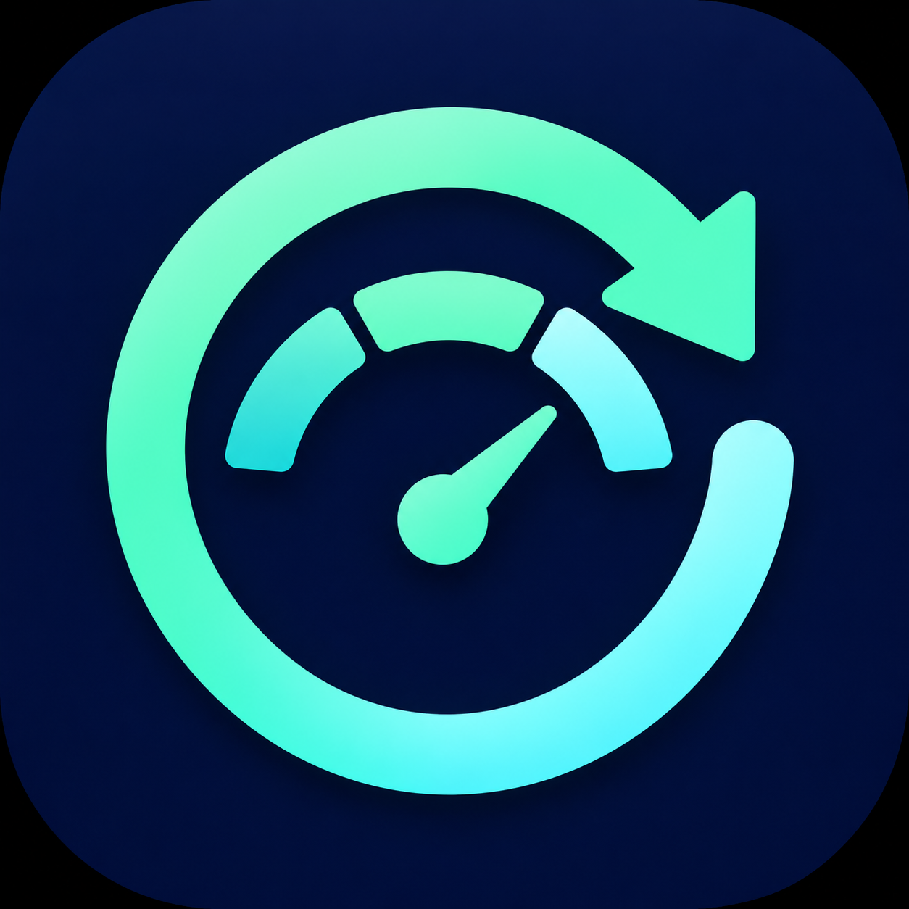

# Codex Quota Steward

<p align="center"></p>

[English](README.md) · [简体中文](README.zh-CN.md)

A native CLIProxyAPI plugin with **persistent per-account reset policies** and
**quota pace reminders**. Its English/Chinese dashboard shows when to slow down to
reach the next reset, or when unused quota is likely to remain at reset time.

Use **中文 / English** to choose one interface language at a time. **Auto / Light /
Dark** controls the full color theme, including forms, cards and notices.
Auto follows the containing management panel when its theme is accessible,
otherwise the system setting. Both choices are remembered in this browser;
switching them preserves unsaved settings.

Version: **0.4.0**. This is an independent plugin, not an upgrade package for
`codex-auto-reset`. MIT licensed.

## Features

- Separate durable `settings.json` and `runtime.json`. Background polling cannot
  overwrite user settings. A successful save means the file was flushed and
  replaced; stale browser edits are rejected using a revision number.
- Accounts default to **off**. Monitor, redeem before credit expiry, and redeem
  when the weekly window is exhausted are separate per-account choices.
- Account policies survive temporary account disappearance and plugin reloads.
  Account identity uses the ChatGPT account ID resolved from credential metadata when available,
  otherwise its credential ID, never the position in an account list.
- Expiring-credit policy targets the earliest expiring available credit.
  Weekly-exhaustion policy ignores five-hour exhaustion and permits at most
  one redemption per seven days. Any verified redemption starts that lock;
  the expiry policy remains independent.
- The redemption journal is flushed **before** contacting the upstream.
  Retries reuse the same credit ID and request ID, including after restart.
  Accepted or ambiguous outcomes are verified rather than spending another
  credit. Missing credit, count decrease, and quota recovery must agree.
- Corrupt state prevents startup; journal write failures stop further automatic
  processing until reload. Neither silently resets consent or redemption history.
- Pace estimates use at least two continuous observations from up to the last
  hour in the same quota window.
  Five-hour and weekly limits are assessed separately. A constrained window
  suppresses encouragement to accelerate. Stale data disables predictions.
- Browser notifications are opt-in, limited to once per account/window/kind/
  deadline per hour within the current page. **The dashboard must remain open.**
  Background reset processing continues independently of the browser.
- Reset history and unresolved attempts are visible. Resolving an ambiguous
  attempt explicitly disables both automatic redemption policies for that
  account and imposes a seven-day weekly-policy lock.

The plugin calls upstream quota and reset-credit endpoints; it does not generate
model requests. It does not automatically change routing speed. Predictions use
quota percentage points per hour, not a guaranteed token budget. Spark and code
review pools are intentionally excluded from the main-window pace calculation.
The seven-day exhaustion policy does not wait for all other CPA accounts to
exhaust; that Magpie routing behavior is not available to this management plugin.

## Curves and server-side notifications

The overview shows observed remaining quota, an exhaustion estimate and the reset
countdown together. Its interactive curve compares real samples with a recent-pace
projection and a budget line that evenly uses the current balance until reset.
Select an account, quota window, and 6-hour / 24-hour / 7-day / 14-day history range.
Hover, touch, or use arrow keys to inspect points. Reset boundaries and collection
gaps break the observed line. Predictions use continuous samples from up to the
last hour and stop when data is stale. These are percentage-based scenarios, not
fixed Token or currency capacities.

History is persisted for up to 14 days, capped at 4,096 samples per account. On
upgrade, the two readings retained by earlier versions are preserved; older
history cannot be reconstructed. No model requests are generated for charts.

**Server-side notifications** work with the browser closed. Channels are disabled
by default. Enabling a channel and saving authorizes real matching alerts; there
is deliberately no real-message test button.

- **Email:** one SMTP sender and 1–50 recipients, entered one per line or separated
  by commas. Each recipient gets a separate message and cannot see the others.
  Up to four deliveries run concurrently. Configure the SMTP host, port, username,
  password/app password and sender. Implicit TLS (usually 465) and STARTTLS
  (usually 587) require certificate verification; plaintext SMTP is not supported.
- **Generic HTTPS webhook:** receives JSON with `id`, `title`, `text`, and `notice`,
  plus an `Idempotency-Key` header. Use a compatible receiver or automation adapter
  for chat bots. A 2xx response acknowledges delivery; redirects are not followed.
- Choose usage-too-fast, unused-quota risk, upcoming natural reset, credit expiry,
  and/or stale-data alerts. The reminder horizon uses the existing reminder-hours
  setting. Notification language is independently selectable.
- A persistent per-account/window/condition/destination journal enforces the
  configured cooldown (default six hours). Failed recipients retry after ten
  minutes; confirmed successes are not resent during their cooldown. Unknown
  delivery outcomes wait for the full cooldown. Email cannot guarantee exactly-once
  delivery when acknowledgements are lost; stable Message-IDs aid reconciliation.
- Delivery records are kept for 30 days. SMTP passwords and webhook URLs are
  write-only in the management API. Blank secret fields preserve saved values;
  explicit clear controls remove them. Files use mode 0600 on Unix, and credentials
  are never stored in browser localStorage. Notification settings are in
  `notifications.json`, and delivery history in `notification-log.json`.

## Installation

Install from the CPA plugin store once the registration is merged, or download
the platform ZIP from this repository's GitHub Releases and install through CPA.
The first stable release is `v0.1.1`; `v0.1.0` is a superseded prerelease.

Configure this plugin's `config_yaml`:

```yaml
data_dir: /CLIProxyAPI/data/cpa-codex-reset-manager
```

**Mount that directory or its parent on persistent storage.** For Docker:

```yaml
volumes:
  - ./data:/CLIProxyAPI/data
```

For desktop installations, set `data_dir` to an absolute writable directory.
Keep `settings.json` and `runtime.json` together when backing up or migrating.
After configuring notifications, include `notifications.json` and
`notification-log.json` too. An enabled channel requires its journal on startup. Changing the
directory during a live reload is rejected; stop the host, copy both files, then
change the path. Removing the persistent volume also removes the settings.

Open **Codex 额度管家** in CPA's plugin menu. Enter the CPA Management Key,
enable monitoring for the desired accounts, and save. By default, the key stays in the current tab’s session storage, so refreshing
the page does not require signing in again. Select **Remember key** to keep it
in this browser across sessions, as in CPA Quota Estimator. Use this option only
on trusted devices. **Forget key** clears this plugin’s saved key. Rejected keys
are cleared and prompt for reconnection. Keys are never written to server-side
plugin storage. Automatic redemption is enabled
only when you explicitly select its policy.

Defaults: polling every 5 minutes, redeeming 30 minutes before expiry, and
accelerate reminders during the last 24 hours before the applicable reset.
The expiry lead must be at least twice the polling interval. Notifications
require browser permission and a secure context (HTTPS or localhost).

### Migrating from Codex Auto Reset

Back up the old plugin's state before any container replacement. Old `v0.1.0`
stores `codex-auto-reset.state.json` in CPA's working directory, which may not
be mounted. See [research notes](docs/RESEARCH.md).

Disable the old plugin's automatic redemption before enabling this one's
redemption policies. There is no shared cross-plugin redemption lock. Existing
settings are **not automatically imported**: account mapping and consent must
be checked in the new dashboard. Monitoring can be enabled first.

## Management API

All management routes are protected by the host's Management Key:

| Method | Path under `/v0/management/cpa-codex-reset-manager` | Purpose |
|---|---|---|
| GET | `/status` | Settings, accounts, snapshots, notices, journal, activity |
| GET | `/history?account=<key>&hours=24` | Observed history and window forecasts |
| GET | `/notifications` | Redacted notification settings and delivery status |
| PUT | `/notifications` | Save notification channels, recipients and cooldown |
| PUT | `/settings` | Replace settings with the current `revision`; persist before acknowledging |
| POST | `/check` | Queue a background quota check |
| POST | `/resolve` | Acknowledge a specific unresolved request ID and disable automatic redemption |

The resource `/v0/resource/plugins/cpa-codex-reset-manager/dashboard` contains
only static HTML. It never embeds account data or secrets. The dashboard fetches
private data through authenticated management routes.

Settings example:

```json
{
  "revision": 0,
  "poll_minutes": 5,
  "lead_minutes": 30,
  "reminder_hours": 24,
  "accounts": {
    "account:example-account-id": {
      "monitor": true,
      "expiring": false,
      "exhausted": false
    }
  }
}
```

Use account keys returned by `/status`. Missing or disabled host credentials are
not processed; their saved policy remains visible. If CPA changes a fallback
credential ID, the old policy is retained and the new identity defaults to off.

## Build and verification

Go 1.22+, a C compiler, and CGO are required.

```bash
go test -race ./...
make build
make package VERSION=0.4.0
python3 tests/abi_smoke.py dist/cpa-codex-reset-manager.so
node tests/browser.mjs
```

Browser tests need Node 22+ and Chrome; set `CHROME` if necessary.
Release CI builds Linux amd64/arm64, macOS amd64/arm64, and Windows amd64.
Each ZIP contains the plugin library at its root; `checksums.txt` verifies all
five archives. No live credits are spent by the automated tests.

## Attribution

The ABI bridge and upstream protocol parsing/client code are adapted from
JefferyZhang2019's Codex Auto Reset under MIT; see
[THIRD_PARTY_NOTICES.md](THIRD_PARTY_NOTICES.md). Magpie informed the policy
design; no Magpie code is included. CPA Quota Estimator informed packaging and
management integration.
