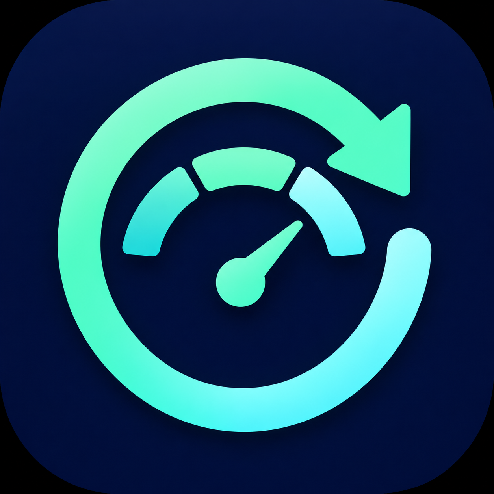

# Codex 额度管家

<p align="center"></p>

[English](README.md) · [简体中文](README.zh-CN.md)

原生 CLIProxyAPI 插件，提供**持久的逐账号重置设置**和**额度使用速度提醒**。
双语管理页面会提示：当前速度可能在重置前用完额度，需要减速；或临近重置仍有较多额度，可以加快有价值任务。

当前版本：**0.2.0**。这是独立插件，不是 `codex-auto-reset` 的升级包。MIT 许可证。

## 功能

- 设置与运行记录分别保存到 `settings.json` 和 `runtime.json`，巡检不会覆盖用户开关。
  文件刷新、替换完成才返回保存成功。版本号防止旧页面覆盖其他页面的新设置。
- 新账号默认关闭。每个账号独立选择监控提醒、重置券到期前兑换、周额度耗尽兑换。
- 账号暂时消失或插件重新加载不会清除设置。优先使用凭证元数据中解析出的 ChatGPT 账号 ID，
  否则使用凭证 ID，不按账号列表中的位置匹配。
- 到期策略优先兑换最早到期的可用券；耗尽策略仅针对周窗口，五小时耗尽不触发。
  每次验证成功的兑换都会启动七天耗尽策略锁；到期策略独立运行。
- 先将固定请求 ID、目标券与兑换前快照写入磁盘，再发兑换请求。
  超时及重启后沿用同一个请求 ID，不换券补偿。兑换成功必须同时确认目标券消失、
  可用数量减一和额度恢复。
- 状态损坏时拒绝启动；运行记录写入失败后停止进一步自动处理，修复后需重新加载。
  不会静默当作新安装，也不会清空授权或兑换记录继续操作。
- 使用同一周期的两个近期样本计算速度。五小时与周窗口分别判断，
  任一窗口受限时抑制加速建议；数据过期时不做预测。
- 浏览器通知需主动授权；当前页面内同一账号、窗口、提醒类型和截止时间每小时最多一次。
  **页面必须保持打开**。服务端自动兑换不依赖页面。
- 页面展示兑换历史与待核验记录。人工核对后解除挂起，会同时关闭该账号两种自动兑换策略，
  并启动七天耗尽策略锁，需要重新保存设置才会再次授权。

插件会查询上游额度和重置券接口，不生成模型请求，不会自动调整路由速度。
预测单位为每小时额度百分点，不是保证可用的 Token 数。Spark 和代码审查额度池不混入主额度预测。
与 Magpie 不同，本插件的周耗尽策略不等待 CPA 所有其他账号也耗尽；
管理插件无法获得 Magpie 的请求级路由候选上下文。

## 安装

上架申请合并后可从 CPA 插件商店安装；也可从本仓库 GitHub Releases 下载平台 ZIP，
通过 CPA 安装。首个稳定版本为 `v0.1.1`，`v0.1.0` 为已被替代的预发布版本。

在该插件的 `config_yaml` 中设置：

```yaml
data_dir: /CLIProxyAPI/data/cpa-codex-reset-manager
```

**必须将目录或其父目录挂载到持久存储。** Docker 示例：

```yaml
volumes:
  - ./data:/CLIProxyAPI/data
```

桌面环境请指定绝对路径且确保可写。备份、迁移必须同时保留两个 JSON 文件。
运行中不允许切换目录；先停宿主、复制两个文件，再改路径。删除持久卷仍然会丢失设置。

打开插件菜单中的 **Codex 额度管家**，输入 CPA Management Key，选择账号并保存。
与额度插件一致：默认只在当前标签页的会话存储中保留密钥，刷新页面无需重新输入；
勾选「在此浏览器记住密钥」后可跨浏览器会话保留，仅建议在可信设备上使用。
「忘记密钥」会清除此插件保存的密钥；密钥失效时会清除并要求重新连接。
密钥不会写入服务端插件数据。自动兑换必须显式选择对应策略。

默认每五分钟巡检、到期前三十分钟兑换、重置前二十四小时开始评估加速提醒。
兑换提前量至少是巡检间隔的两倍。浏览器通知需要权限及 HTTPS 或 localhost。

### 从原插件迁移

容器替换前先备份原插件状态。旧版 `v0.1.0` 将 `codex-auto-reset.state.json`
写入 CPA 工作目录，该位置可能没有挂载。详见[研究记录](docs/RESEARCH.md)。

启用新插件自动兑换前，先关闭原插件的自动兑换。两个插件之间没有共享兑换锁。
不会自动导入旧设置：需要在新页面核对账号并重新授权；可以先仅开启监控。

## 管理 API

所有管理接口由 CPA Management Key 保护：

| 方法 | `/v0/management/cpa-codex-reset-manager` 下的路径 | 用途 |
|---|---|---|
| GET | `/status` | 设置、账号、额度、提醒、兑换记录与历史 |
| PUT | `/settings` | 带当前 `revision` 替换设置，持久成功才返回 |
| POST | `/check` | 将额度巡检加入后台队列 |
| POST | `/resolve` | 按具体请求 ID 确认已人工核验，并关闭自动兑换 |

公开资源 `/v0/resource/plugins/cpa-codex-reset-manager/dashboard` 仅包含静态 HTML，
不嵌入任何账号数据或秘密。私有数据通过受认证的管理接口读取。

设置示例：

```json
{
  "revision": 0,
  "poll_minutes": 5,
  "lead_minutes": 30,
  "reminder_hours": 24,
  "accounts": {
    "account:example-account-id": {
      "monitor": true,
      "expiring": false,
      "exhausted": false
    }
  }
}
```

账号键以 `/status` 返回值为准。宿主凭证消失或被禁用时不处理该账号，已有设置保留。
如果只能使用凭证 ID 而 CPA 又改变了 ID，旧设置会保留，新标识默认关闭。

## 构建与验证

需要 Go 1.22+、C 编译器和 CGO：

```bash
go test -race ./...
make build
make package VERSION=0.2.0
python3 tests/abi_smoke.py dist/cpa-codex-reset-manager.so
node tests/browser.mjs
```

浏览器测试需要 Node 22+ 和 Chrome，可通过 `CHROME` 指定路径。
发布流程构建 Linux amd64/arm64、macOS amd64/arm64、Windows amd64。
每个 ZIP 根目录放置动态库，`checksums.txt` 校验全部五个平台。测试不会消耗真实重置券。

## 致谢

ABI 桥接与上游协议解析、客户端代码改编自 JefferyZhang2019 的 Codex Auto Reset，
保留 MIT 声明，见 [THIRD_PARTY_NOTICES.md](THIRD_PARTY_NOTICES.md)。
借鉴了 Magpie 的策略设计，没有复制 Magpie 代码。打包和管理接口参考 CPA Quota Estimator。
